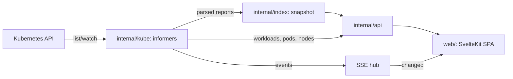

# Architecture

## Data flow

1. `internal/kube` starts informers for every trivy-operator CRD the API
   server has (rechecked every minute, so installing the operator later
   works), plus ReplicaSets, Jobs, workloads, pods, nodes and namespaces.
   Informer transforms parse reports into the small Go types in
   `internal/reports` and drop the raw objects; SBOMs keep only the fields
   the UI shows. The full CycloneDX document is fetched from the API on
   download.
2. Every informer event marks the index stale and schedules a debounced
   Server-Sent Event. `internal/index` rebuilds one immutable snapshot on
   the next request: rows per finding, images keyed by digest, owner
   resolution (ReplicaSet → Deployment, Job → CronJob) and the stale flag
   for ReplicaSets scaled to zero.
3. `internal/query` parses the filter language. Each list endpoint matches
   rows, computes facet counts (each facet ignores its own term), groups,
   sorts and pages on the server, so the browser never gets thousands of
   rows.
4. The SPA keeps all list state in the URL and refetches when the SSE
   generation changes.

## Counting rules

- A vulnerability is counted once per image (digest), however many
  workloads run the image. Workload and namespace pages count per workload.
- Old ReplicaSet revisions are hidden everywhere unless `stale=1` (the
  "Include old ReplicaSets" box).
- trivy-operator often records only failed checks
  (`report.recordFailedChecksOnly`), so pass counts can be missing.
- Compliance reports in summary mode have no resource list; a control's
  failing resources come from joining its check IDs with the config audit,
  RBAC and infra reports.
