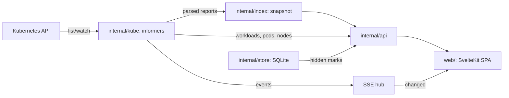

# Architecture

## Data flow

1. `internal/kube` starts informers for every trivy-operator CRD the API
   server has (rechecked every minute, so installing the operator later
   works), plus ReplicaSets, Jobs, workloads, pods, nodes and namespaces.
   Informer transforms parse reports into the small Go types in
   `internal/reports` and drop the raw objects; SBOMs keep only the fields
   the UI shows. The full CycloneDX document is fetched from the API on
   download.
2. Every informer event marks the index stale and schedules a debounced
   Server-Sent Event. `internal/index` rebuilds one immutable snapshot on
   the next request: rows per finding, images keyed by digest, owner
   resolution (ReplicaSet → Deployment, Job → CronJob, a pod reported on
   its own → the custom resource that controls it, such as an operator's
   database cluster) and the stale flag for ReplicaSets scaled to zero.
3. `internal/query` parses the filter language. Each list endpoint matches
   rows, computes facet counts (each facet ignores its own term), groups,
   sorts and pages on the server, so the browser never gets thousands of
   rows.
4. `internal/store` keeps the hidden marks (bun ORM, pure-Go SQLite, so
   `CGO_ENABLED=0` still works; bun leaves PostgreSQL possible later). Tables
   `users` and `marks`; migrations are bun Go migrations in
   `internal/store/migrations`. Marks belong to a user, but there is only one
   "anonymous" user for now, also with OIDC on. Without `-database-url` the
   marks live in memory. Changing a mark changes the SSE generation.
5. The SPA keeps all list state in the URL and refetches when the SSE
   generation changes.

## Counting rules

- A vulnerability or exposed secret is counted once per image (digest),
  however many workloads run the image; namespace totals likewise once per
  namespace, workload pages once per workload.
- When several reports cover one resource (a report per pod of a custom
  resource, or two ReplicaSets during a rollout), only the newest report's
  checks count. The same check on two containers is two findings.
- Old ReplicaSet revisions are hidden everywhere unless `stale=1` (the
  "Include old ReplicaSets" box).
- trivy-operator often records only failed checks
  (`report.recordFailedChecksOnly`), so pass counts can be missing.
- Compliance reports in summary mode have no resource list; a control's
  failing resources come from joining its check IDs with the config audit,
  RBAC and infra reports.

## Hiding

- A mark targets an image (repository, all tags), a CVE in one image, a CVE
  everywhere, an exposed secret, a check everywhere, a check on one
  resource, a workload or a namespace.
- Hiding hides the findings the target has at that moment. Finding IDs leave
  out image digest and tag, so a rebuild with the same packages stays hidden;
  a new CVE or package version is a new finding and shows. Posting the same
  target again also hides what is new. `GET /api/v1/hidden` reports per mark
  the findings hidden at the time, how many are still `hiding` and how many
  are `new`.
- The snapshot itself has every finding. `internal/api` asks
  `Snapshot.Hide` for a copy without the user's hidden findings and caches it
  per user until the snapshot or the marks change, so counts, lists, facets,
  CSV and the dashboard agree. `hidden=1` on list and detail endpoints uses
  the full snapshot. Search, SBOM and raw reports are not filtered.
